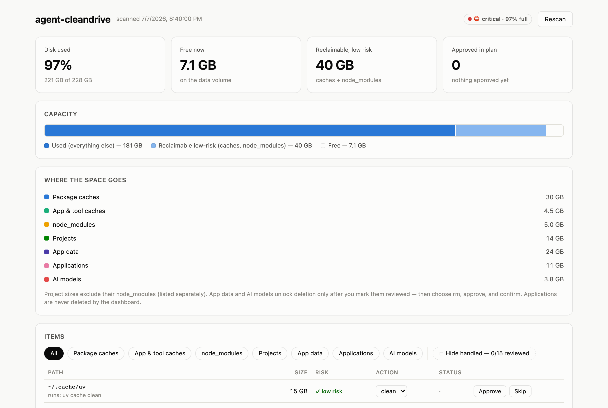
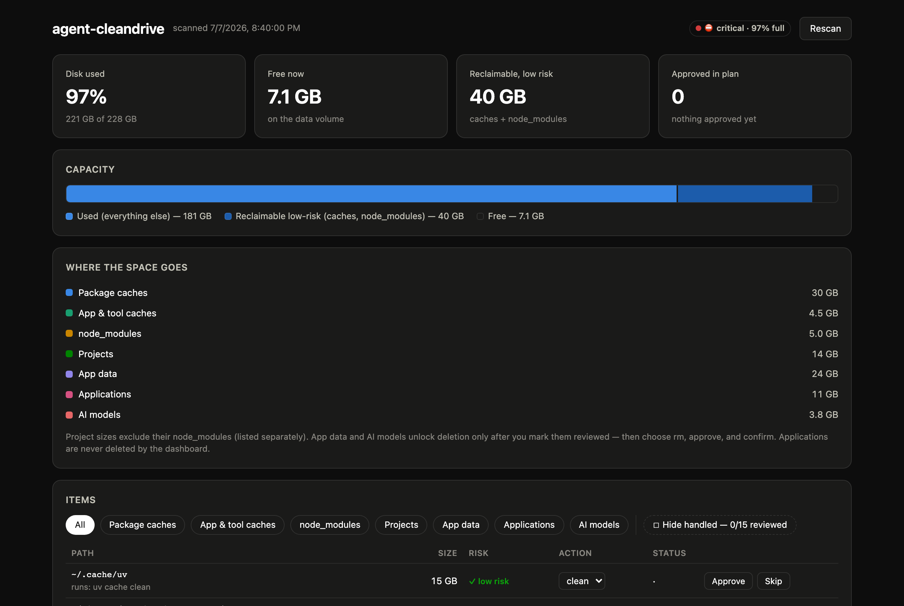

<div align="center">

# 🧹 agent-cleandrive

### The disk cleaner your AI agent can't misuse.

**Your agent proposes the cleanup, you approve it, and the tool enforces the rules: a project can never be deleted, only archived and verified.**
Scan → sort by risk → approve → clean caches, archive projects to your own drive with checksum
verification, or offload big videos iCloud-style. Works with Claude Code, Codex, Cursor, or no agent at all.

<sub>Built for, and on, an 8 GB MacBook Air that runs several Claude Code sessions a day.</sub>

[](https://github.com/kaiser-data/agent-cleandrive/actions/workflows/test.yml)
[](https://www.npmjs.com/package/agent-cleandrive)


 


<br>


</div>

> **Try it in 60 seconds** (read-only until you approve something):
> ```bash
> npx agent-cleandrive scan     # ~1–3 min, nothing is changed
> npx agent-cleandrive serve    # dashboard → http://localhost:4499
> ```
> Or in Claude Code: `/plugin install cleandrive --marketplace kaiser-data/agent-cleandrive`, then ask *"my disk is full, what can I clean?"*

---

## Why this exists

Mac disk cleaners fall into two camps. **Dumb** ones blindly wipe `~/Library/Caches` and hope.
**Dangerous** ones offer "free up 200 GB" in one click and take last week's project with it.

agent-cleandrive starts from one hard rule: **nothing is deleted unless it can be regenerated, or has
been verified on another disk first.** Caches can go, because apps rebuild them. Projects can only
leave the machine by being copied to your drive and checksum-verified before the local copy is
removed. Paths you never want touched, such as your Claude Code history, are **hard-locked** and
refused even when someone forges the action.

| Without it | With agent-cleandrive |
|---|---|
| "Free up 40 GB?" — and you don't know what's in it | Every item has a category, a risk level and a reason |
| Deleting a project is one `rm -rf` away | Projects can't be `rm`-ed at all, only archived and verified |
| Old videos are either on the Mac or gone | `offload` leaves a `.cloud` placeholder; `fetch` restores it byte-for-byte |
| `df` says 56% full while macOS says the disk is full | Real APFS capacity: `used / (used + available)` |
| The disk fills up again and you don't know why | Field-tested list of where the space actually goes ([below](#field-notes-where-the-space-actually-went)) |

### Built on an 8 GB Mac

I'm [Martin Kaiser](https://github.com/kaiser-data). I do agent-heavy development, with several Claude
Code sessions, MCP servers, a browser and a local model, on a **base M2 MacBook Air: 8 GB RAM,
228 GB disk**. That's a deliberate choice. Small hardware forces lean habits, and lean habits make
agent work cheaper wherever it runs.

The catch is that on a small Mac, **memory and disk are one problem.** With 8 GB, macOS swaps hard;
on a normal workday swap sits around **7.9 of 8 GB**, and those swap files live in the same APFS
container as your files. Each `npm install` or `uv sync` an agent runs adds gigabytes of
dependencies. So the disk fills from two sides, and when free space runs out, swap has nowhere to
grow and the whole machine stalls.

agent-cleandrive is how I keep that machine usable without buying a bigger one. It makes the disk side
predictable: dependency churn gets cleaned often and safely, finished projects move to a drive
on my tailnet, and big videos become placeholders. Free space stays free, so swap has room. It
manages disk only; it doesn't touch RAM or running processes.

<table>
<tr>
<td width="50%" valign="top"><b>Light</b><br></td>
<td width="50%" valign="top"><b>Dark</b><br></td>
</tr>
</table>

---

## Install

| Way | Command | Config & data live in |
|---|---|---|
| **Claude Code plugin** | `/plugin install cleandrive --marketplace kaiser-data/agent-cleandrive` | `~/.config/cleandrive/` |
| **npm** | `npm i -g agent-cleandrive` → command `cleandrive` (or `npx agent-cleandrive …`) | `~/.config/cleandrive/` |
| **git clone** | `git clone https://github.com/kaiser-data/agent-cleandrive && cd cleandrive && cp config.example.json config.json` | the repo (`config.json`, `data/`) |

Needs macOS and Node ≥ 20 (Linux support is next on the roadmap). **No dependencies:** pure Node stdlib plus the system's `du`, `rsync`
and `ssh`. On first run it writes a default `config.json`. Point `projectRoots` at your
code folders and, if you want archiving, set `remote`.

---

## How it works

1. **Scan.** `cleandrive scan` sizes caches, package caches, `node_modules`, projects, app data,
   apps (with last-used date) and models, then writes `data/latest.json`.
2. **Plan.** Each item gets a category, which fixes what is allowed. You approve items in the
   dashboard or with `cleandrive approve <id>`.
3. **Preview.** `cleandrive execute --dry-run` shows exactly what will happen.
4. **Execute.** In the dashboard you type `FREE`; in the CLI you run `cleandrive execute`. Every
   step is logged to `data/actions.log`.

| Category | Risk | What it allows | Example |
|---|---|---|---|
| `pkgcache` | low | official clean (npm/uv/brew/pnpm/bun), or rm | *`~/.npm` — 935 MB* |
| `cache` | low | rm, the app rebuilds it | *`~/Library/Caches/com.spotify.client`* |
| `node_modules` | low | rm, reinstall per project | *`~/code/old-app/node_modules`* |
| `projects` | medium | archive / archive+rm / keep, **never a bare rm** | *a repo untouched for 60+ days* |
| `appdata` | review | rm only after you mark it reviewed | *`~/Library/Application Support/Slack`* |
| `models` | review | rm after review, or via the owning tool | *`~/.ollama`* |
| `apps` | manual | never deleted, shown with size and last-used date | *an 800 MB app unopened for 5 months* |

---

## The safety model

This is the reason the tool exists. Every rule is enforced in the executor, not just in the UI,
and **[covered by tests](test/safety.test.mjs)** that run against a fake `$HOME`.

- **Allowlist by construction.** Only paths that came out of the scan are actionable; forged plan
  entries are ignored.
- **`rm` is category-gated.** It works only for `pkgcache`, `cache`, `node_modules`, and for
  `appdata`/`models` after an explicit review. A project can leave only via `archive+rm`.
- **Archive, verify, then delete.** `rsync -aHR` to the remote, then a second `rsync -c` checksum
  pass. The local copy goes only if that pass reports zero content differences.
- **The drive must really be there.** Before every archive or offload, the tool checks over SSH
  that `remote.path` sits on the expected drive (`remote.uuid`), not on an empty mount point on the
  remote's system disk, and that there is room for the item + 5%.
- **Protected paths are hard-locked.** `config.protected` entries are flagged 🔒, forced to `keep`,
  and refused at execution. The default protects `~/.claude`, `~/.claude-mem` and the Claude
  desktop app's data. `config.extraCaches` can carve out exact regenerable subpaths, and only those.
- **Protected roots.** `~`, `~/Documents`, `~/Desktop`, `~/Downloads`, `~/Pictures`, `~/Library`
  are refused as direct targets, whatever the plan says.
- **Local only.** The dashboard binds to `127.0.0.1`. There is no cloud, no account and no telemetry.

---

## Offload: iCloud-style, to your own drive

Big idle files, mostly videos, move to your remote drive. A small `<name>.cloud` placeholder stays
on the Mac, and `fetch` brings the file back byte-for-byte. Nothing runs in the background, on
either machine.

```bash
cleandrive offload-candidates                 # read-only: big idle media, duplicates first
cleandrive offload ~/Movies/talk.mov --dry-run
cleandrive offload ~/Movies/talk.mov          # → talk.mov.cloud (1 KB)
cleandrive fetch ~/Movies/talk.mov.cloud      # → talk.mov, sha256-verified
```

The local file is unlinked only after the **remote sha256 equals the local hash** and the file is
**unchanged since hashing**. Symlinks, hard links, open files (`lsof`), `~/Library`, `.git`,
`node_modules`, photo and media libraries, protected paths and pins are refused. Storage is
content-addressed, so duplicates are stored once and re-offloading a fetched file uploads nothing.
The design is in [`docs/offload-strategy.md`](docs/offload-strategy.md).

---

## Any agent can drive it

The CLI speaks `--json` and the state is plain files, so any coding agent can run the whole loop.
The safety gates live in the executor, not in the prompt: **an agent that misreads the plan still
cannot delete a project or a protected path.**

- **Claude Code:** install the plugin. Its [skill](skills/cleandrive/SKILL.md) teaches the workflow: read the scan, propose a plan grouped by risk, act only on the items you confirm.
- **Codex, Cursor, Gemini CLI, others:** paste this into the agent's instructions (`AGENTS.md`, rules file):

  > To free disk space, use the `cleandrive` CLI. Run `cleandrive state --json`, propose a plan grouped by category with sizes, and wait for my confirmation of specific items. Then `cleandrive approve <ids>`, show `cleandrive execute --dry-run`, and run `cleandrive execute` only after I say yes. Never delete files by hand that cleandrive refuses.

```bash
cleandrive state --json                    # items: {id, path, kb, category, suggest, note}
cleandrive approve <id…> --action=archive+rm
cleandrive execute --dry-run               # Claude shows you this first
cleandrive execute                         # only after you say yes
```

> *"Here are 33 GB of package caches and 14 GB of `node_modules`, all regenerable. Clean them?
> And 3 projects untouched since spring, 21 GB. Archive and verify them to your drive first?"*

agent-cleandrive was itself built in Claude Code sessions. That is why protecting agent history is a
default: **the tool knows what it must never delete.**

---

## Field notes: where the space actually went

Lessons from running agent-cleandrive on an 8 GB / 228 GB MacBook Air under daily agent workloads,
which kept hitting 98% full (Sept–Nov 2026).
These shaped the code and the [skill](skills/cleandrive/SKILL.md).

| What we saw | What it taught us |
|---|---|
| `df` reported 56% while macOS said the disk was full | APFS volumes share one container. Real capacity is `used / (used + available)`. |
| A scan ran for over an hour at 0% CPU | `du` blocks forever on other apps' privacy-protected containers. Every `du` now has a timeout, and unreadable paths are listed in `scan.blocked`. |
| Swap stood at 7.9 of 8 GB on a normal workday | On an 8 GB Mac, swap is part of disk usage. Keep several GB free, or the machine stalls before the disk is technically full. |
| Roughly 100 GB of "used" space never appeared in any scan | macOS privacy (TCC) hides Downloads, Documents, Desktop, Mail and Trash from the terminal. Grant **Full Disk Access** or the numbers stay low. |
| 36 GB came back within five days of a cleanup | Most likely not a leak but dependency churn: `node_modules`, `.venv` and package caches regrow with every install. Clean them often; they are low-risk. |
| Aerial wallpaper videos regrew to 5.9 GB in two days | Switching the wallpaper is not enough. The **screen saver and lock screen** also download Aerials. |
| A Claude Code plugin cache held 17 old versions, most ~800 MB each (9.6 GB) | Tool and plugin caches keep old versions side by side. Keep the active one (check its manifest); the rest is dead weight. |
| "Archive OK", but the files landed on the remote's boot disk | The USB drive wasn't mounted, so the mount point was just an empty folder. Archives now check the drive's UUID first. |
| The USB drive didn't mount after a reboot | `x-systemd.device-timeout=10` in fstab is too short for a spinning HDD. Use 90 s. |
| SSH to the Tailscale short name timed out | The `100.x` IP worked. Use the IP as `remote.host` if the name is flaky. |
| `rsync --info=progress2` failed on the Mac | macOS ships openrsync ("2.6.9 compatible"). Use portable flags only. |
| Checksum verification flagged unchanged files | ext4 can't represent macOS symlink permissions. Ignore metadata-only diffs; still fail on any content, size or missing-file change. |
| A cache `rm` failed halfway | The browser was still running. Quit the app first, then re-approve the item. |
| `approve $IDS` recorded a single bogus id | zsh doesn't word-split `$IDS`. Pass ids as `$(cat ids.txt)`. |

---

## CLI reference

| Command | What it does |
|---|---|
| `scan [--json]` | Rescan, categorize, write `data/latest.json` |
| `state [--json]` | Current scan and plan, with item ids |
| `serve` | Dashboard at `http://localhost:4499` |
| `approve <id…> [--action=rm\|clean\|archive\|archive+rm]` | Approve items |
| `skip <id…>` · `review <id…>` | Skip items · mark reviewed (unlocks rm for `appdata`/`models`) |
| `execute [--dry-run]` | Run all approved actions |
| `remote-test` | SSH reachability, drive mounted, free space |
| `offload-dryrun` | `rsync -n` the approved archive items |
| `offload-candidates [--min=200] [--days=30]` | Big idle media and duplicates (read-only) |
| `offload <file\|dir…> [--dry-run]` | Verified upload, leaves `<name>.cloud` |
| `fetch <file\|stub\|dir…> [--dry-run]` | Restore offloaded files, sha256-verified |
| `offloaded` · `offload-verify` · `pin <path>` | List · re-hash every remote copy · keep a path local |

## Remote drive setup

1. Attach a drive to any Linux machine you can SSH into: a Raspberry Pi, a Jetson, a NAS, an old
   laptop. Tailscale makes it reachable from anywhere without opening ports.
2. Set `remote.host`, `remote.user`, `remote.path` and, ideally, `remote.uuid` (from `findmnt -n -o UUID -T <path>`) in `config.json`, or in the dashboard's remote card.
3. Run `cleandrive remote-test`. It must report the drive as mounted.

Archives keep each item's path relative to your home folder, so the remote mirrors your Mac's
layout and restores are obvious.

---

## Architecture

```
bin/cleandrive.js     CLI + agent connector (every command scriptable, --json where useful)
lib/scan.js           scanner: categories, sizes, staleness, app last-used, blocked paths
lib/actions.js        executor: validation gates, rm/clean/archive, checksum verify, audit log
lib/offload.js        offload/fetch: content-addressed remote store, .cloud stubs, scrub
lib/server.js         zero-dependency HTTP API + static host, 127.0.0.1 only
lib/util.js           process runner with timeouts, atomic JSON writes, config resolution
ui/index.html         single-file dashboard (colorblind-safe palette, light/dark)
skills/cleandrive/    Claude Code skill shipped with the plugin
test/                 safety-model tests (node:test, fake $HOME)
```

## Development

```bash
npm test          # 15 tests, ~0.3 s, never touches your real home folder
```

**Roadmap** ([PLAN.md](PLAN.md)): **Linux support** (XDG caches, Docker images, journald, snap revisions) · MCP server for non-CLI agents · item lifecycle and checkbox selection in the dashboard ·
"free up X GB" goal mode · known space-hog catalog · coverage bar (what the scan can't see) ·
recursive project discovery and stale subfolders · scan speed.

---

<div align="center">

MIT licensed · built by [Martin Kaiser](https://github.com/kaiser-data) with [Claude Code](https://claude.com/claude-code), on 8 GB of RAM

**Clean without fear.**

</div>
